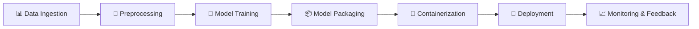
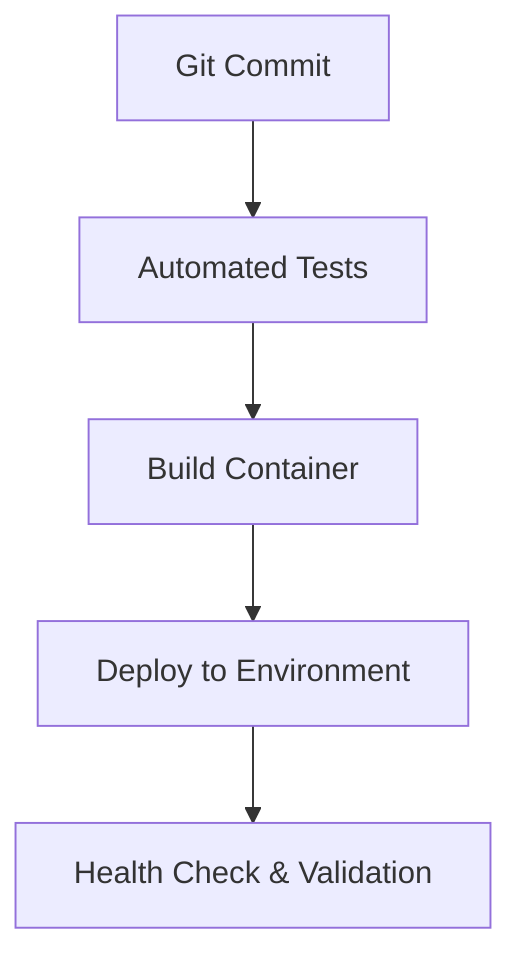

<!-- ===================================================== -->
<!-- MLOps Pipeline System — README.md -->
<!-- Premium • Interactive • Brand-Consistent -->
<!-- ===================================================== -->

<div align="center">


<br/>


<br/><br/>

<a href="#-quickstart"><b>Quickstart</b></a> •
<a href="#-lifecycle-architecture"><b>Lifecycle</b></a> •
<a href="#-pipeline-structure"><b>Pipeline</b></a> •
<a href="#-automation-logic"><b>Automation</b></a> •
<a href="#-production-boundaries"><b>Production</b></a> •
<a href="#-recruiter-snapshot"><b>Recruiter Snapshot</b></a> •
<a href="#-contact"><b>Contact</b></a>

</div>

---


<!-- quickstart:start -->
# 🚀 Quickstart

[](https://github.com/Navyagowda2714/MLOPS_PROJECT/actions/workflows/ci.yml)

**Requirements:** Python 3.10+ (or Docker). The dataset is included, so everything runs offline.

```bash
git clone https://github.com/Navyagowda2714/MLOPS_PROJECT.git
cd MLOPS_PROJECT
python -m venv .venv && source .venv/bin/activate   # Windows: .venv\Scripts\activate
pip install -r requirements.txt

# 1. Train: ingestion → validation → transformation → model selection
python -m src.pipeline.train_pipeline
#    artifacts/ now holds train/test splits, validation_report.json,
#    preprocessor.joblib, model.joblib and metrics.json

# 2. Serve
python app.py                                   # → http://127.0.0.1:5000/health
curl http://127.0.0.1:5000/features             # expected input columns
```

**Docker** (trains during the build, then serves with gunicorn):

```bash
docker build -t mlops-pipeline .
docker run -p 5000:5000 mlops-pipeline
```

**Tests**

```bash
pip install -r requirements-dev.txt
pytest -v
```

**Current results** (held-out test set, model selected on recall for the malignant class):

| Model | Recall | Precision | F1 | ROC-AUC |
|---|---|---|---|---|
| **Logistic Regression** (promoted) | 0.976 | 0.976 | 0.976 | 0.995 |
| Random Forest | 0.929 | 0.951 | 0.940 | 0.994 |
| Gradient Boosting | 0.905 | 0.974 | 0.938 | 0.989 |

To use a different dataset, change `data.source_path` and `data.target_column` in `config/config.yaml`.
<!-- quickstart:end -->

---

# 🔁 Lifecycle Architecture

<details open>
<summary><b>🧬 From Training → Production (click to collapse)</b></summary>

<br/>



</details>

This is not just training a model.  
This is designing the system around the model.

---

# 🏗 Pipeline Structure

<details open>
<summary><b>⚙️ Engineering-Oriented Breakdown (click to collapse)</b></summary>

<br/>

```
config/config.yaml              ← every path, split ratio, model and threshold lives here
data/breast_cancer.csv          ← raw dataset (UCI Breast Cancer Wisconsin)
src/
├── components/
│   ├── data_ingestion.py       ← stratified train/test split
│   ├── data_validation.py      ← schema, dtype, missing-value and label checks
│   ├── data_transformation.py  ← impute + scale, fitted on train only
│   ├── model_trainer.py        ← trains LR / RF / GB, promotes best by recall
│   └── prediction.py           ← loads promoted artifacts, scores new records
├── pipeline/
│   ├── train_pipeline.py       ← ingestion → validation → transformation → training
│   └── predict_pipeline.py     ← batch / single-record inference
└── utils/                      ← logger, YAML/joblib helpers, PipelineError
app.py                          ← Flask API: /health, /features, /predict
Dockerfile                      ← trains at build time, serves with gunicorn
tests/                          ← pytest: components, pipelines, API
.github/workflows/ci.yml        ← tests → end-to-end train → docker build + smoke test
```

Each directory reflects lifecycle separation.

Training logic is not mixed with serving logic.  
Inference code is not mixed with experimentation.

That separation is production maturity.

</details>

---

# ⚙️ Automation Logic

<details open>
<summary><b>🔁 CI/CD Flow for ML Systems (click to collapse)</b></summary>

<br/>



</details>

Automation ensures:

- Reproducible builds  
- Version-controlled models  
- Consistent deployments  
- Reduced manual intervention  

ML without automation is experimentation.  
ML with automation is engineering.

---

# 🧱 Production Boundaries

Instead of another diagram, here is the system segmentation view:

```
┌────────────────────────────┐
│  Experimentation Layer     │
│  • Model training          │
│  • Hyperparameter tuning   │
└────────────┬───────────────┘
             │
┌────────────▼───────────────┐
│  Packaging Layer           │
│  • Model serialization     │
│  • Versioning              │
└────────────┬───────────────┘
             │
┌────────────▼───────────────┐
│  Serving Layer             │
│  • REST API                │
│  • Inference endpoint      │
└────────────┬───────────────┘
             │
┌────────────▼───────────────┐
│  Observability Layer       │
│  • Logging                 │
│  • Performance metrics     │
└────────────────────────────┘
```

This prevents:

- Hidden training-serving skew  
- Unversioned models  
- Deployment drift  

---

# 🌟 System Impact

This project demonstrates:

- End-to-end ML lifecycle ownership  
- Production-ready system design  
- Model versioning discipline  
- CI/CD integration for ML  
- Containerized deployment thinking  
- Observability awareness  

This moves from:

```
Train Model → Save Model
```

to

```
Design System → Automate → Deploy → Monitor → Improve
```

---

# 🎯 Recruiter Snapshot

<details open>
<summary><b>📌 What This Proves in One Glance (click to collapse)</b></summary>

<br/>

<div align="center">

<table>
<tr>
<td width="50%" valign="top">

### Engineering Capability
- Structured pipeline design  
- Automation mindset  
- Environment reproducibility  
- Clean separation of layers  

</td>
<td width="50%" valign="top">

### ML Maturity
- Lifecycle awareness  
- Production readiness  
- Deployment responsibility  
- Monitoring integration  

</td>
</tr>
</table>

</div>

</details>

---

# 📬 Contact

<div align="center">

<a href="https://www.linkedin.com/in/navyashree-byregowda-472821196/">

</a>

<a href="https://github.com/Navyagowda2714">

</a>

<a href="mailto:navyashreebyregowda@gmail.com">

</a>

<br/><br/>
<sub>MLOps Pipeline System — engineering discipline for production-grade machine learning.</sub>

</div>
